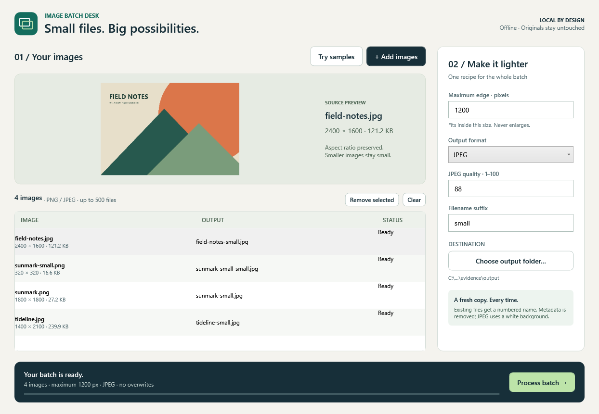

# Image Batch Desk

Prepare a lighter set of images without touching your originals. An offline Windows desk for batch resizing, PNG/JPEG conversion, predictable names and cancellable exports.

## Run

Open **[ImageBatchDesk.exe](demo/windows-x64/ImageBatchDesk.exe)** on Windows x64. Keep the accompanying samples and licenses. The compressed executable includes .NET; no SDK, account, service or internet connection is needed. First launch extracts native runtime components to the Windows temporary directory. The executable is unsigned.

1. Select **Try samples**, **Add images**, or drop PNG/JPEG files into the window.
2. Choose a maximum edge, output format and filename suffix. Smaller images never enlarge. JPEG quality controls compression; transparent pixels become white in JPEG.
3. Choose an existing destination separate from every source folder. Create a new folder in the Windows folder picker if needed.
4. Inspect the output names and select **Process batch**. **Cancel** or Escape stops after the current codec operation. Finished copies remain available through **Open output**.

For example, a 2400 × 1600 source at 1200 pixels becomes 1200 × 800. `field-notes.jpg` becomes `field-notes-small.jpg`; another run creates `field-notes-small-02.jpg`. Existing files are never replaced. A file created by another program after planning causes a per-image failure rather than an overwrite.

Select a row to preview its source. After processing, selecting a row displays result details. Remove selected rows or clear the session to prepare another batch. Ctrl+O opens the file picker; standard Tab navigation reaches controls. The queue and settings are held only for the current session.

## Boundaries

- Windows x64 only. Verified execution: Windows 11, build 26200, .NET runtime 10.0.10 bundled in the EXE.
- Up to 500 files, 80 MiB per file and 40 million decoded pixels per image. Maximum edge: 32–8192 pixels. Destination: at most 10,000 existing entries.
- PNG and JPEG only; animated PNG and multi-frame inputs are rejected. No recursion, GIF, HEIC, WebP, RAW, SVG, crop or enlargement.
- EXIF orientation is baked into pixels; output metadata is removed. This is a publishing utility, not an archival or color-proofing pipeline. ICC, HDR, high-bit-depth fidelity and exact preservation of source compression are not promised.
- Processing is sequential. Decode/render/encode operations cannot be interrupted mid-call. Normal cancellation removes the current temporary file; power loss or process termination may leave `.image-desk-*.tmp` files. The queue is not a crash-recovery log.
- Use local writable drives. Network shares, symbolic-link races, physical low-disk conditions, other Windows versions, screen readers and full accessibility conformance are unverified.
- Packaged integration checks call the real WPF window's workflows in-process and capture its rendered client area. Native OS mouse/keyboard injection and file-dialog automation were not tested. See [verification](docs/VERIFICATION.md) for the exact distinction.

## Development

See [build and architecture](docs/DEVELOPMENT.md), [demo instructions](demo/README.md) and [licenses](docs/LICENSES.md). Source and original samples are MIT licensed; bundled runtime components keep their own notices. No AI service or model is part of this application.
